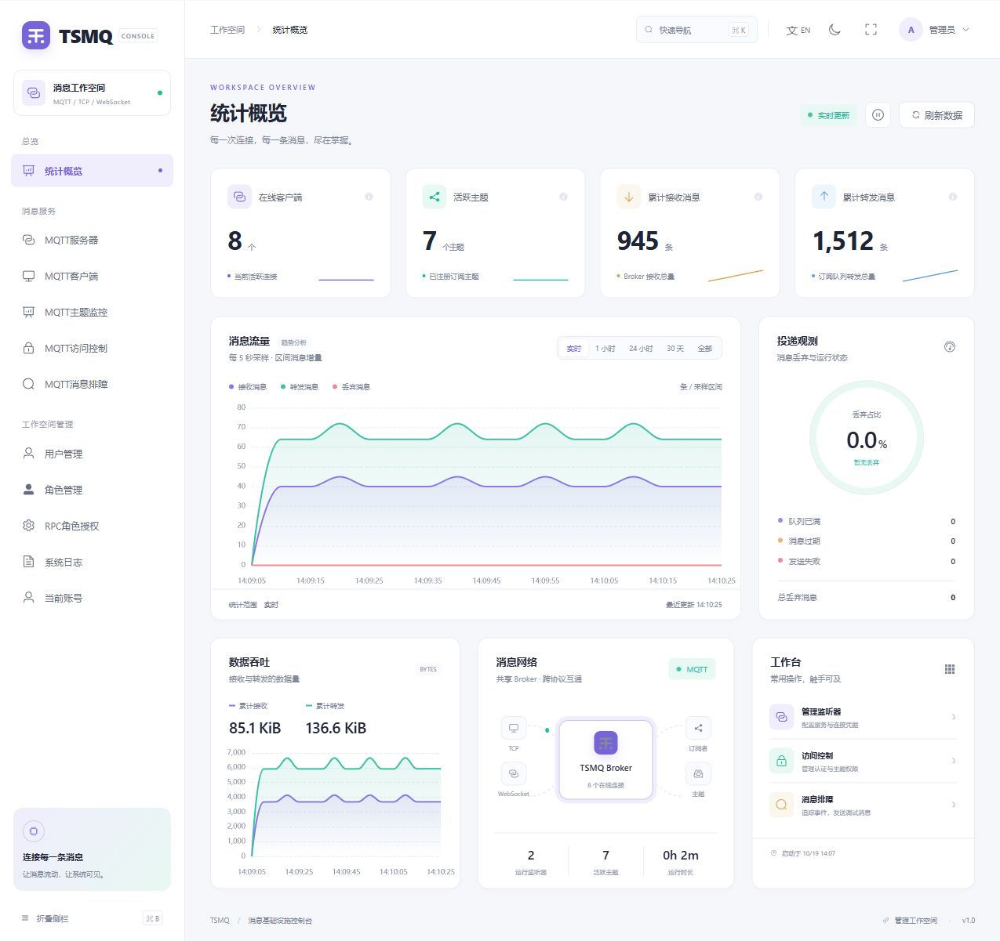
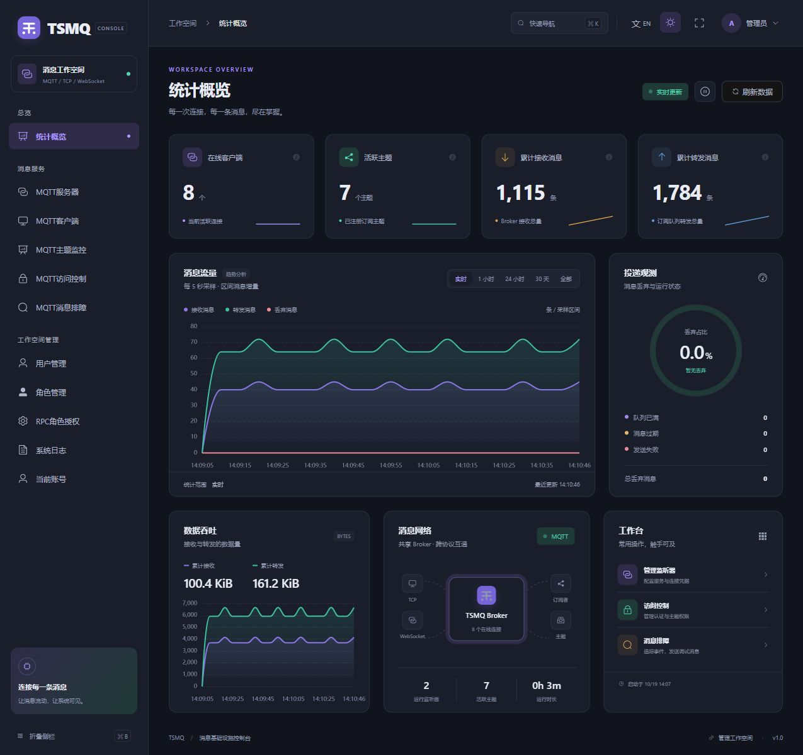
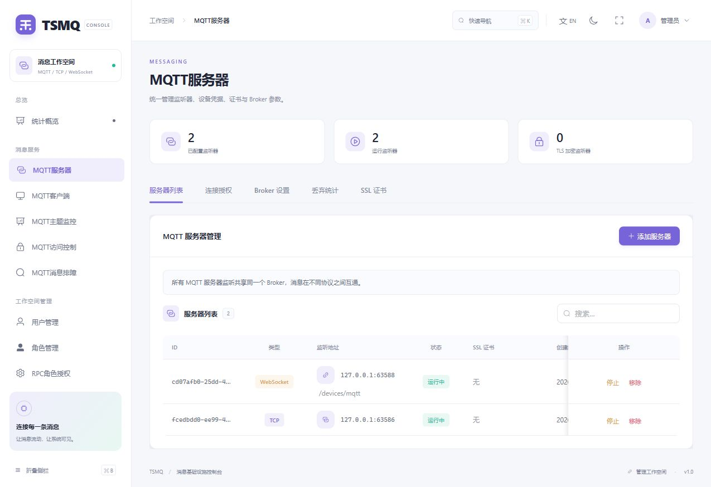
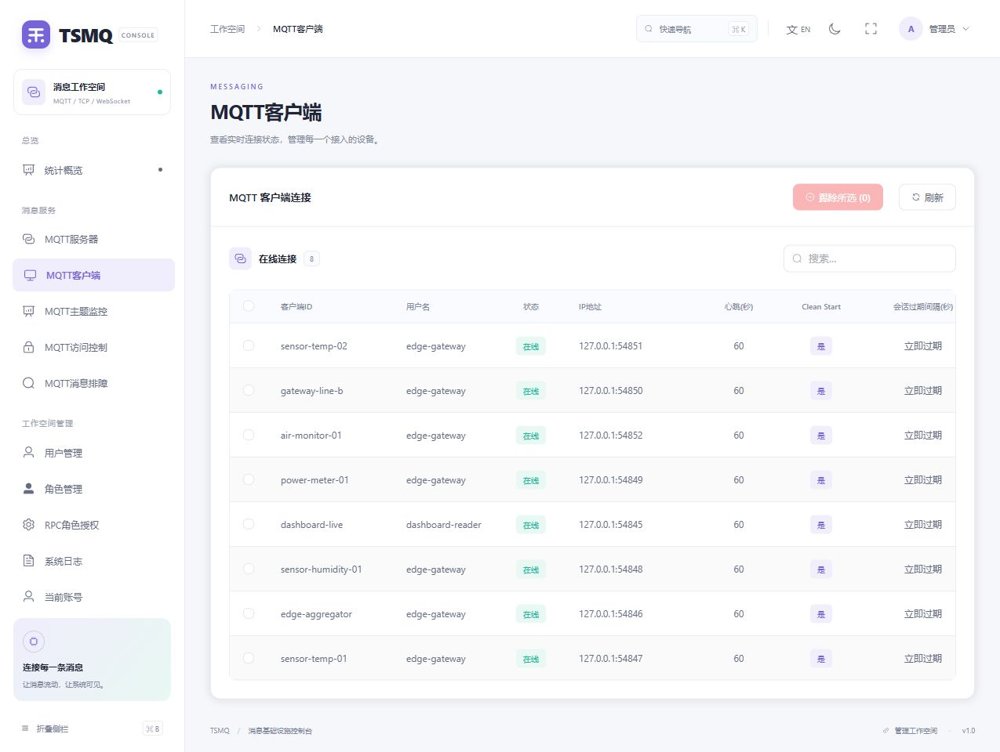
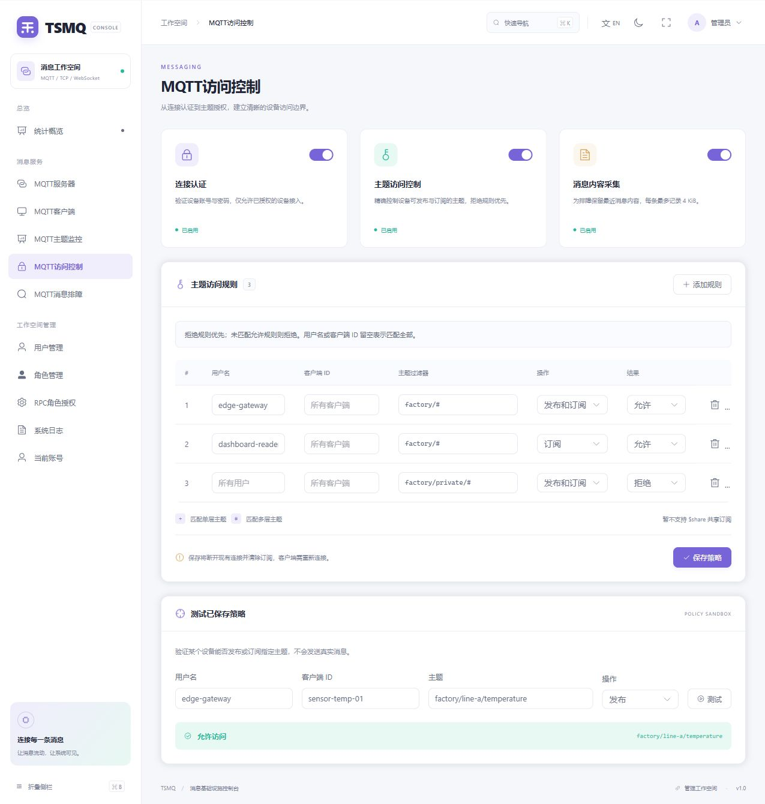
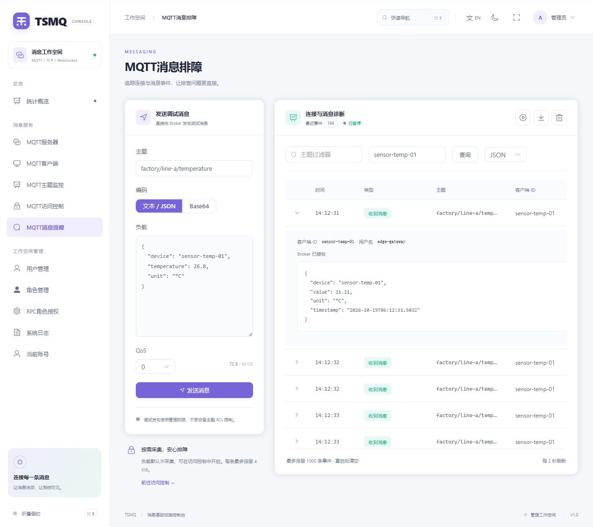
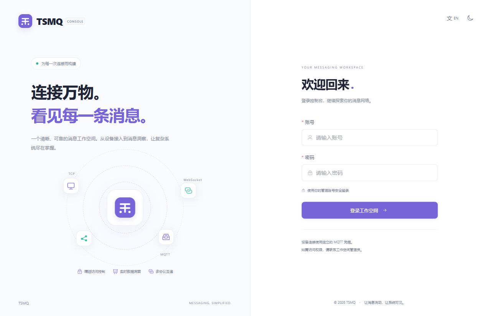

# TSMQ

**自带 Web 管理控制台的轻量级 MQTT 消息服务。**

连接设备、查看消息流量、配置访问权限、定位通信问题，都可以在浏览器中完成。适用于物联网接入、边缘网关、设备联调和小型消息服务部署，基于 [TouchSocket](https://touchsocket.net/) 构建。

[下载最新版本](https://github.com/RRQM/TSMQ/releases) · [下载并运行](#下载并运行) · [看看能做什么](#web-管理一览) · [C# 客户端集成](#c-直接调用管理功能) · [开源协议](LICENSE)



> 截图来自独立演示环境，使用实际 MQTT 客户端连接和消息流量。界面对应当前仓库版本，发布包功能以相应版本说明为准。

## 下载并运行

### 1. 下载发布包

打开 [Releases](https://github.com/RRQM/TSMQ/releases)，展开所选版本的 **Assets**，下载对应平台的完整发布包。

| 平台 | 选择的附件 |
| --- | --- |
| Windows x64 | `tsmq-server-win-x64-*.zip` |
| macOS Apple Silicon | `tsmq-server-osx-arm64-*.zip` |
| Linux x64 / ARM64 | 对应 `amd64` / `arm64` 的 Docker 镜像 `.tar` 文件，或使用下方容器镜像 |

请下载发布附件，而不是页面底部的 `Source code`。Windows、macOS 发布包为 AOT 程序，无需另外安装 .NET 或 Node.js。

### 2. 解压并启动

**Windows：** 将压缩包完整解压到可写目录，双击 `TSMQServer.App.exe`，保持运行窗口打开。

**macOS：** 解压后，在程序目录打开终端运行：

```sh
chmod +x TSMQServer.App
./TSMQServer.App
```

启动成功后，窗口会显示实际监听地址、本机及网卡对应的 Web 地址、MQTT 监听器状态，以及数据库与日志目录。

<details>
<summary>Linux / Docker 运行方式</summary>

使用发布的容器镜像启动，数据和日志分别保存在持久卷中：

```sh
docker run -d \
  --name tsmq \
  --restart unless-stopped \
  --entrypoint /app/TSMQServer.App \
  --workdir /data \
  -p 7789:7789 \
  -p 1883:1883 \
  -p 8083:8083 \
  -v tsmq-data:/data \
  -v tsmq-logs:/app/logs \
  ghcr.io/rrqm/tsmq-server:latest
```

也可以下载 Release 中对应架构的 Docker `.tar` 文件，通过 `docker load -i 文件名.tar` 导入，并将上述命令最后的镜像名替换为导入后的镜像名与标签。

`1883`、`8083` 是预留的 MQTT 映射端口，仍需登录 Web 控制台创建相应的 TCP、WebSocket 监听器。使用其他端口时，需要同步调整容器端口映射。

</details>

### 3. 打开 Web 控制台

浏览器访问 **[http://127.0.0.1:7789/](http://127.0.0.1:7789/)**。如果调整过管理端口，以启动窗口显示的地址为准；从其他电脑访问时，将 `127.0.0.1` 换成服务器 IP。

首次启动会初始化管理账号：

| 账号 | 密码 |
| --- | --- |
| `admin` | `admin123` |

登录后请在“用户管理”中修改当前账号的默认密码。Web 管理账号和 MQTT 设备账号分别管理。

管理账号及 MQTT 认证账号的密码使用 PBKDF2-SHA256 存储：600,000 次迭代、独立的 16 字节随机盐及 32 字节派生密钥。接口不会返回密码或密码哈希。TLS 证书加载所需的口令不属于账号密码，不参与此哈希处理。

**旧数据库升级注意：** 不兼容原明文密码。首次启动新版时，将清空不符合当前哈希格式的账号密码，并撤销对应管理账号的登录会话；不会自动迁移密码，也不会重新设置现有管理员的默认密码。升级前请停服并妥善备份数据库，准备好新的密码哈希，由运维自行更新 `Users.Password`（包括管理员）和 `MqttAuthUsers.PasswordHash`。哈希格式为 `$tsmq$pbkdf2-sha256$v1$600000$<Base64盐>$<Base64派生密钥>`，可由 `TSMQServer.Db.PasswordHasher.Hash` 生成。未重置的账号无法通过密码认证；数据库备份仍可能含有旧明文，需按敏感数据保护或销毁。

### 4. 接入第一个 MQTT 客户端

1. 在 **MQTT服务器 → 连接授权** 中添加设备使用的 MQTT 用户名和密码。
2. 在 **MQTT服务器 → 服务器列表** 中新增并启动 TCP 或 WebSocket 监听器。
3. 在 **MQTT访问控制** 中检查连接认证；需要限制主题时，开启主题访问控制并配置允许规则。
4. 使用 MQTTX、MQTT Explorer 或设备 SDK，填写服务器 IP、所建监听器的端口及 MQTT 凭据，连接后发布、订阅消息。

**默认的 `7789` 是 Web 与管理接口端口。MQTT 接入端口由你在控制台创建，不会默认自动开放 `1883`。**

## Web 管理一览

### 统计大屏：一眼看清消息服务的运行状态

在线客户端、活跃主题、累计收发消息、数据吞吐与丢弃原因集中呈现。支持实时刷新、暂停观察和历史趋势切换。



### 监听器管理：在浏览器里接入设备

动态添加、启动、停止 TCP 与 WebSocket 监听器，管理 MQTT 设备凭据、TLS 证书及 Broker 参数。同一实例内的各监听器共享 Broker，TCP 和 WebSocket 客户端之间可以交换消息。



### 客户端管理：找到每一个在线设备

查看客户端 ID、用户名、连接地址、连接时间等信息，支持搜索和断开连接；配合主题监控，查看订阅者及主题消息统计。



### 访问控制：决定谁能连接、能操作哪些主题

分别控制连接认证、主题 ACL 和诊断负载采集。规则可按用户名、客户端 ID、主题过滤器及发布／订阅操作设置，并支持在页面上测试已保存策略。



启用主题 ACL 后，拒绝规则优先，未匹配允许规则的请求会被拒绝。主题过滤器支持 `+`、`#`；保存策略会撤销已有连接和订阅，客户端需要重新连接。

### 消息排障：从连接事件追到消息内容

在同一页面发送调试消息、筛选客户端和主题事件，查看连接拒绝、权限拒绝、订阅及消息记录。负载可按文本、JSON 或 Hex 查看，事件支持暂停、清空视图和导出。



负载默认不采集，开启后每条最多保留 4 KiB；诊断事件为内存中的近期记录，重启后清空。管理端调试发布使用管理权限，不受设备主题 ACL 限制。

### 团队管理与界面偏好

通过用户、角色和 RPC 权限管理，为不同成员配置可访问的页面与操作。系统日志支持按日期、级别、分类和关键词检索。

控制台支持 **浅色 / 深色主题、中英文切换、紧凑侧栏、快捷页面搜索及手机访问**，外观与语言偏好自动保存在当前浏览器。



## 日常使用

| 想做什么 | 去哪里 |
| --- | --- |
| 看运行状态和消息趋势 | 统计概览 |
| 创建 MQTT 端口、配置设备账号和证书 | MQTT服务器 |
| 查设备是否在线、断开指定连接 | MQTT客户端 |
| 查主题及订阅者、观察主题流量 | MQTT主题监控 |
| 配置连接认证和主题权限 | MQTT访问控制 |
| 发送测试消息、追踪收发事件 | MQTT消息排障 |
| 配置主题消息存储、保留期限并查询历史 | MQTT消息持久化 |
| 管理团队账号和操作权限 | 用户管理 / 角色管理 / RPC角色授权 |
| 查服务端异常和运行记录 | 系统日志 |

## C# 直接调用管理功能

除了 Web 控制台，TSMQ 也支持 **C# 直接引用客户端 DLL，以强类型 API 调用 Web 管理端背后的服务能力**，无需打开浏览器，也无需手写 HTTP 请求。适合将管理能力集成到自己的控制台、桌面应用、后台服务或自动化运维工具中。

客户端接口和实现位于 **`TSMQServer.Core.dll`**（命名空间 `TSMQServer.Core.Clients`），不是 Avalonia 界面程序集。统一接口 `IRemoteService` 提供三种传输实现：

| 实现 | 协议 | 默认管理地址 |
| --- | --- | --- |
| `WebApiRemoteService` | HTTP WebApi | `http://127.0.0.1:7789` |
| `DmtpRemoteService` | DMTP RPC | `tcp://127.0.0.1:7789` |
| `JsonRpcRemoteService` | WebSocket JSON-RPC | `ws://127.0.0.1:7789/wsjsonrpc` |

这些客户端可调用统计概览、监听器增删与启停、设备连接授权、在线客户端查询与踢除、主题统计、访问控制、诊断与消息发布，以及用户、角色、RPC 权限和日志管理等接口。这里指的是服务端管理能力，不包含浏览器主题、语言、侧栏等界面偏好，也不是用于设备收发消息的 MQTT 客户端。

先连接管理服务，再调用 `LoginAsync`；成功后客户端会保存登录 Token，并自动携带到后续请求中。调用结果通过 `IsSuccess`、`Message` 和泛型结果的 `Value` 获取。权限校验与 Web 控制台一致，需使用管理账号，而不是 MQTT 设备账号；不需要时调用 `LogoutAsync` 并释放底层连接。

源码集成可直接引用 `src\TSMQServer\TSMQServer.Core\TSMQServer.Core.csproj`。已有 DLL 的项目可引用 `TSMQServer.Core.dll`，但必须同时部署其匹配版本的 TouchSocket 等运行依赖，不能只复制单个 DLL；源码项目引用会自动解析依赖。当前源码目标框架为 .NET 10。

### 控制台示例

[demo/TSMQ.ManagementConsole](demo/TSMQ.ManagementConsole) 提供可运行的 .NET 10 控制台项目，直接使用上述客户端接口，不依赖 Web 前端或 Avalonia。示例采用源码项目引用，便于在仓库中直接编译；运行时调用的仍是 `TSMQServer.Core.dll` 中的客户端实现。

| 文件 | 职责 |
| --- | --- |
| `Program.cs` | 入口、服务地址、隐藏密码输入及退出码 |
| `Connection\ManagementConnection.cs` | WebApi 连接、登录、注销及资源释放 |
| `Commands\ManagementCommands.cs` | 菜单、管理 API 调用、结果输出与交互式消息发布 |
| `TSMQ.ManagementConsole.csproj` | 控制台配置及客户端契约项目引用 |

可直接打开 `demo\TSMQ.Demo.slnx` 解决方案，或在仓库根目录执行 `dotnet build .\demo\TSMQ.Demo.slnx` 编译。运行时，在仓库根目录执行 `dotnet run --project .\demo\TSMQ.ManagementConsole`，启动后依次输入管理服务地址（`http://服务器IP:管理端口`）、管理账号和密码。地址提示会显示默认值 `http://127.0.0.1:7789`，直接回车使用默认地址，也可手动输入其他地址；不接收命令行地址参数。执行前请先启动 TSMQ 服务端，并准备有相应操作权限的管理账号。密码仅在终端隐藏输入，不写入源码或命令行。

菜单展示统计概览、监听器列表、在线客户端、主题监控、访问策略、最近诊断事件和消息发布。查询失败会显示服务端错误；发布消息需要显式确认，默认 QoS 0、不保留消息。示例不会自动创建或删除监听器、修改访问策略或清理服务端数据。诊断负载是否可见取决于服务端采集配置；管理端消息发布使用管理权限，不受设备主题 ACL 限制。示例使用 HTTP，请仅在可信网络中连接，跨公网应通过安全通道保护管理流量。

## 主题消息持久化

在 Web 的 **MQTT消息持久化** 页面启用存储并配置主题过滤器，支持 MQTT `+`、`#` 通配符。匹配的 TCP / WebSocket 客户端消息及管理端调试发布消息会保存至现有 SQLite 数据库；重叠规则不会重复保存。默认关闭，启用后仅保存新消息，不回补历史。

保存内容包含实际主题、发布客户端、用户名、UTC 接收时间、QoS、Retain 标志和完整原始二进制负载，不受消息排障的 4096 字节采集上限限制。页面支持按主题、客户端、时间范围查询，按消息序号倒序分页，并查看 UTF-8 或 Base64 内容。保留天数为 1–3650 天，默认 30 天；启动和保存策略时执行清理，运行中每小时清理一次，停用采集后仍会清理过期数据。缩短保留期限会删除过期消息，清理不会立即缩小 SQLite 文件。

此功能是消息历史归档，不是 MQTT Retain 或离线会话恢复，也不提供历史重放；仅记录通过访问控制且进入消息接收处理流程的发布消息，不归档 Broker 自动发送的遗嘱。采用同步等待入库的方式，不使用可能丢失数据的内存队列；开启后磁盘写入会增加消息处理延迟，入库异常通过现有服务日志报告。持久化相关管理接口沿用 JWT 和 RPC 动态角色授权，消息内容可能含敏感数据，应限制历史查询权限并定期备份数据库。

## 运行与维护

- **更换管理端口：** 修改发布目录中 `appsettings.json` 的 `Server.Port`，重启生效。MQTT 监听器端口在 Web 中管理。
- **查看日志：** 默认写入程序目录下的 `logs` 文件夹。控制台显示 Info 及以上日志，文件保留 Debug 详情。
- **备份与升级：** 先停止服务，再备份运行目录中的 `TSMQ.db` 和自定义配置；升级时保留数据库及原有配置，从原运行目录启动。
- **远程访问：** 使用启动窗口显示的网卡地址，并按需放行管理端口和已配置的 MQTT 端口。`0.0.0.0` 表示监听所有网卡，访问时应使用实际 IP 或域名。
- **Windows 后台运行：** 发布包内提供 `create.bat`、`start.bat`、`stop.bat`、`delete.bat`，可使用管理员权限管理 Windows 服务。

当前提供单实例 Broker 管理，同一实例内支持多监听器互通；暂不支持集群和 `$share` 共享订阅。

## 基准测试

基准项目位于 `benchmark`，使用 BenchmarkDotNet 对比 MQTTnet 与 TouchSocket 客户端和 Broker。运行全部基准：

```powershell
cd benchmark
.\run-benchmarks.ps1
```

也可使用较短的基准作快速检查，或按 BenchmarkDotNet 筛选用例：

```powershell
.\run-benchmarks.ps1 -Quick
.\run-benchmarks.ps1 -Quick -Filter '*ForwardMessages*'
```

测试矩阵覆盖 TouchSocket、MQTTnet 两种 Broker，1 KiB、4 KiB、8 KiB 消息负载，QoS 0/1/2，以及 MQTT 3.1.1 和 5.0。客户端发布基准由两种客户端分别连续发布 1,000 条消息；Broker 转发基准使用 MQTTnet 客户端发布，并等待订阅端收到和校验全部 1,000 条消息。完整矩阵共 108 个用例：客户端发布 72 个，Broker 转发 36 个。结果文件写入 `benchmark\BenchmarkDotNet.Artifacts\results`。

### 最近一次报告

报告生成于 2026-11-11，测试环境为 Windows 11、Intel Core i7-13700、.NET SDK 11.0.100，基准运行时为 .NET 10.0.15；BenchmarkDotNet 版本为 0.15.8。完整运行耗时约 21 分 18 秒，执行了 108 个用例。

以下按 QoS 等级列出全部参数组合。每个单元格依次为**平均耗时 / 托管内存分配量**，均对应一次处理 1,000 条消息的基准操作；KB、MB 沿用报告单位。客户端发布表记录发布调用耗时，Broker 转发表还包含等待订阅端接收及校验的时间，两类基准的耗时应分别比较。

#### QoS 0（AtMostOnce）

**客户端连续发布 1,000 条消息**

| Broker | 负载 | MQTT 版本 | TouchSocket 客户端：耗时 / 分配量 | MQTTnet 客户端：耗时 / 分配量 |
| --- | --- | --- | ---: | ---: |
| TouchSocket | 1 KiB | 3.1.1 | 2.664 ms / 230.33 KB | 25.100 ms / 687.65 KB |
| TouchSocket | 1 KiB | 5.0 | 2.844 ms / 376.82 KB | 26.009 ms / 687.53 KB |
| TouchSocket | 4 KiB | 3.1.1 | 4.150 ms / 502.59 KB | 26.744 ms / 687.57 KB |
| TouchSocket | 4 KiB | 5.0 | 4.091 ms / 1144 KB | 28.968 ms / 664.79 KB |
| TouchSocket | 8 KiB | 3.1.1 | 7.045 ms / 516.99 KB | 28.313 ms / 664.3 KB |
| TouchSocket | 8 KiB | 5.0 | 7.216 ms / 516.78 KB | 28.814 ms / 664.3 KB |
| MQTTnet | 1 KiB | 3.1.1 | 3.669 ms / 1074 KB | 23.309 ms / 3588.04 KB |
| MQTTnet | 1 KiB | 5.0 | 3.793 ms / 1212.36 KB | 25.540 ms / 3580.53 KB |
| MQTTnet | 4 KiB | 3.1.1 | 5.877 ms / 7519.11 KB | 26.181 ms / 9569.93 KB |
| MQTTnet | 4 KiB | 5.0 | 5.611 ms / 7415.19 KB | 26.260 ms / 9424.49 KB |
| MQTTnet | 8 KiB | 3.1.1 | 8.181 ms / 15803.93 KB | 25.614 ms / 17630.8 KB |
| MQTTnet | 8 KiB | 5.0 | 7.646 ms / 15535.47 KB | 25.998 ms / 17498.8 KB |

**Broker 转发并校验 1,000 条消息**（发布端和订阅端均使用 MQTTnet 客户端）

| 负载 | MQTT 版本 | TouchSocket Broker：耗时 / 分配量 | MQTTnet Broker：耗时 / 分配量 |
| --- | --- | ---: | ---: |
| 1 KiB | 3.1.1 | 30.66 ms / 5.18 MB | 43.80 ms / 7.89 MB |
| 1 KiB | 5.0 | 30.68 ms / 5.18 MB | 35.78 ms / 7.82 MB |
| 4 KiB | 3.1.1 | 30.82 ms / 11.54 MB | 44.80 ms / 19.65 MB |
| 4 KiB | 5.0 | 31.48 ms / 11.19 MB | 45.27 ms / 19.59 MB |
| 8 KiB | 3.1.1 | 31.10 ms / 19.01 MB | 67.18 ms / 35.44 MB |
| 8 KiB | 5.0 | 31.92 ms / 19 MB | 46.12 ms / 35.39 MB |

#### QoS 1（AtLeastOnce）

**客户端连续发布 1,000 条消息**

| Broker | 负载 | MQTT 版本 | TouchSocket 客户端：耗时 / 分配量 | MQTTnet 客户端：耗时 / 分配量 |
| --- | --- | --- | ---: | ---: |
| TouchSocket | 1 KiB | 3.1.1 | 67.255 ms / 915.1 KB | 87.737 ms / 2302.27 KB |
| TouchSocket | 1 KiB | 5.0 | 64.126 ms / 915.1 KB | 89.467 ms / 2303.54 KB |
| TouchSocket | 4 KiB | 3.1.1 | 79.275 ms / 914.92 KB | 101.248 ms / 2305.56 KB |
| TouchSocket | 4 KiB | 5.0 | 81.692 ms / 914.92 KB | 110.243 ms / 2305.04 KB |
| TouchSocket | 8 KiB | 3.1.1 | 73.341 ms / 914.92 KB | 95.312 ms / 2302.47 KB |
| TouchSocket | 8 KiB | 5.0 | 95.357 ms / 914.92 KB | 92.639 ms / 2302.82 KB |
| MQTTnet | 1 KiB | 3.1.1 | 70.494 ms / 4305 KB | 92.821 ms / 5764.1 KB |
| MQTTnet | 1 KiB | 5.0 | 67.445 ms / 4304.98 KB | 90.893 ms / 5801.3 KB |
| MQTTnet | 4 KiB | 3.1.1 | 80.635 ms / 10376.11 KB | 91.738 ms / 11761.27 KB |
| MQTTnet | 4 KiB | 5.0 | 77.612 ms / 10375.22 KB | 84.007 ms / 11732.45 KB |
| MQTTnet | 8 KiB | 3.1.1 | 75.027 ms / 18445.53 KB | 87.900 ms / 19868.19 KB |
| MQTTnet | 8 KiB | 5.0 | 78.308 ms / 18446.17 KB | 88.014 ms / 19720.53 KB |

**Broker 转发并校验 1,000 条消息**（发布端和订阅端均使用 MQTTnet 客户端）

| 负载 | MQTT 版本 | TouchSocket Broker：耗时 / 分配量 | MQTTnet Broker：耗时 / 分配量 |
| --- | --- | ---: | ---: |
| 1 KiB | 3.1.1 | 58.54 ms / 7.43 MB | 101.56 ms / 11.09 MB |
| 1 KiB | 5.0 | 57.54 ms / 7.53 MB | 97.37 ms / 11.09 MB |
| 4 KiB | 3.1.1 | 54.62 ms / 13.23 MB | 96.90 ms / 22.81 MB |
| 4 KiB | 5.0 | 57.10 ms / 13.22 MB | 112.52 ms / 22.81 MB |
| 8 KiB | 3.1.1 | 364.14 ms / 20.84 MB | 124.67 ms / 38.54 MB |
| 8 KiB | 5.0 | 184.09 ms / 21.1 MB | 130.22 ms / 38.53 MB |

#### QoS 2（ExactlyOnce）

**客户端连续发布 1,000 条消息**

| Broker | 负载 | MQTT 版本 | TouchSocket 客户端：耗时 / 分配量 | MQTTnet 客户端：耗时 / 分配量 |
| --- | --- | --- | ---: | ---: |
| TouchSocket | 1 KiB | 3.1.1 | 159.861 ms / 1485.41 KB | 192.828 ms / 4117.66 KB |
| TouchSocket | 1 KiB | 5.0 | 161.391 ms / 1485.41 KB | 205.484 ms / 4117.61 KB |
| TouchSocket | 4 KiB | 3.1.1 | 180.784 ms / 1654.17 KB | 215.995 ms / 4117.52 KB |
| TouchSocket | 4 KiB | 5.0 | 183.283 ms / 1722.24 KB | 211.956 ms / 4257.68 KB |
| TouchSocket | 8 KiB | 3.1.1 | 189.221 ms / 1485.23 KB | 217.872 ms / 4117.24 KB |
| TouchSocket | 8 KiB | 5.0 | 160.766 ms / 1485.41 KB | 204.893 ms / 4116.34 KB |
| MQTTnet | 1 KiB | 3.1.1 | 141.766 ms / 5937.79 KB | 171.319 ms / 8582.71 KB |
| MQTTnet | 1 KiB | 5.0 | 156.884 ms / 5937.17 KB | 172.081 ms / 8661.34 KB |
| MQTTnet | 4 KiB | 3.1.1 | 158.687 ms / 12008.58 KB | 176.353 ms / 14605.74 KB |
| MQTTnet | 4 KiB | 5.0 | 142.908 ms / 12008.13 KB | 166.882 ms / 14506.61 KB |
| MQTTnet | 8 KiB | 3.1.1 | 159.051 ms / 20078.14 KB | 171.849 ms / 22547.3 KB |
| MQTTnet | 8 KiB | 5.0 | 151.894 ms / 20078.14 KB | 168.812 ms / 22737.48 KB |

**Broker 转发并校验 1,000 条消息**（发布端和订阅端均使用 MQTTnet 客户端）

| 负载 | MQTT 版本 | TouchSocket Broker：耗时 / 分配量 | MQTTnet Broker：耗时 / 分配量 |
| --- | --- | ---: | ---: |
| 1 KiB | 3.1.1 | 85.71 ms / 10.3 MB | 185.36 ms / 15.92 MB |
| 1 KiB | 5.0 | 85.58 ms / 10.19 MB | 184.93 ms / 15.98 MB |
| 4 KiB | 3.1.1 | 88.71 ms / 16.12 MB | 184.42 ms / 27.57 MB |
| 4 KiB | 5.0 | 89.70 ms / 16.12 MB | 187.01 ms / 27.75 MB |
| 8 KiB | 3.1.1 | 260.04 ms / 24.02 MB | 217.92 ms / 43.34 MB |
| 8 KiB | 5.0 | 488.15 ms / 24 MB | 205.18 ms / 43.24 MB |

### 测试结论

- **客户端发布：** TouchSocket 客户端在 QoS 0 的全部 12 组同条件比较中平均耗时更低，MQTTnet 与 TouchSocket 的耗时比为 3.13–9.42；QoS 1 有 11/12 组平均耗时更低，QoS 2 为 12/12 组。托管内存分配量在全部 36 组比较中的 35 组更低；例外为 TouchSocket Broker、4 KiB、MQTT 5.0、QoS 0。
- **Broker 转发：** TouchSocket 在 QoS 0 的全部 6 组中平均耗时更低；QoS 1 和 QoS 2 在 1 KiB、4 KiB 下的各 4 组也更低，但在 8 KiB 下的各 2 组均高于 MQTTnet。TouchSocket Broker 在全部 18 组同条件比较中的托管内存分配量均更低。
- **大负载与波动：** TouchSocket Broker 在 8 KiB、QoS 1、MQTT 3.1.1 下为 364.14 ms，标准差 260.760 ms；8 KiB、QoS 2、MQTT 5.0 下为 488.15 ms，标准差 238.879 ms。这些组合存在较大波动，需要复测并定位，不能据此认为某一实现对所有负载都有优势。

本轮结果表明，TouchSocket 客户端的 QoS 0 发布耗时优势明显，TouchSocket Broker 在 1–4 KiB 消息转发中同时具有较低的平均耗时和分配量；8 KiB、QoS 1/2 的转发耗时与稳定性仍有改进空间。基准直接启动两种 Broker，未包含 TSMQ 的 Web 管理、访问控制及 SQLite 持久化链路，实际部署性能还需结合业务配置评估。

## 相关链接

[发布下载](https://github.com/RRQM/TSMQ/releases) · [问题反馈](https://github.com/RRQM/TSMQ/issues) · [TouchSocket 官网](https://touchsocket.net/) · [TouchSocket 仓库](https://github.com/RRQM/TouchSocket)

本项目采用 [Apache License 2.0](LICENSE) 开源协议。
