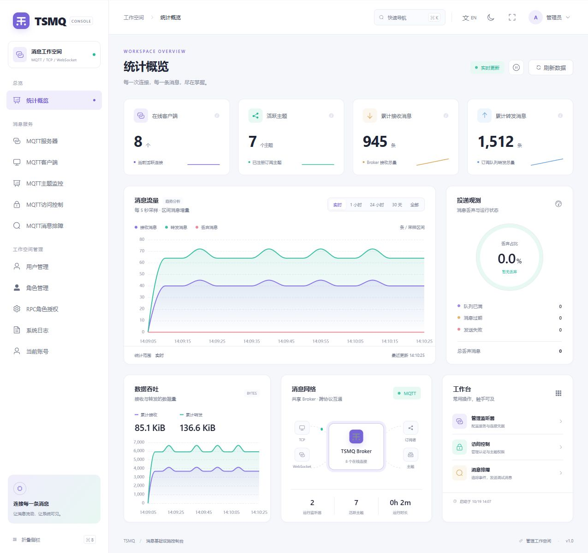
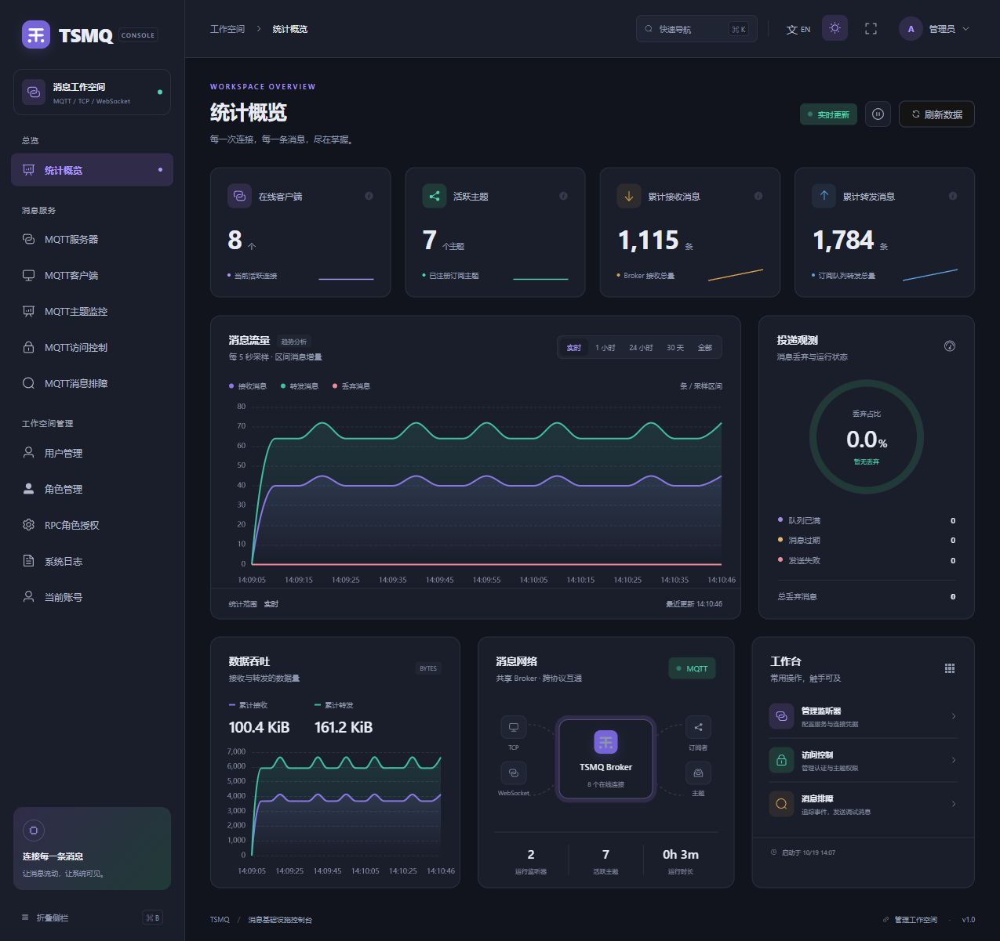
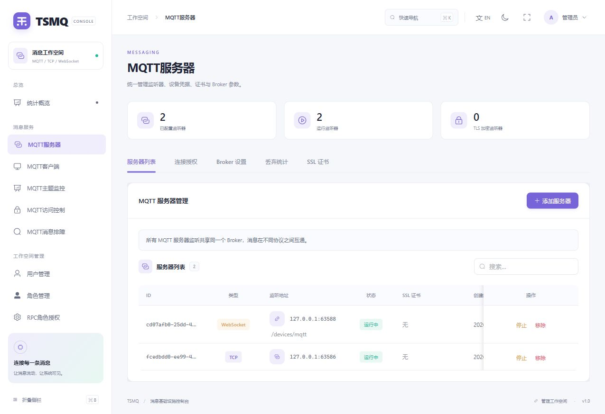
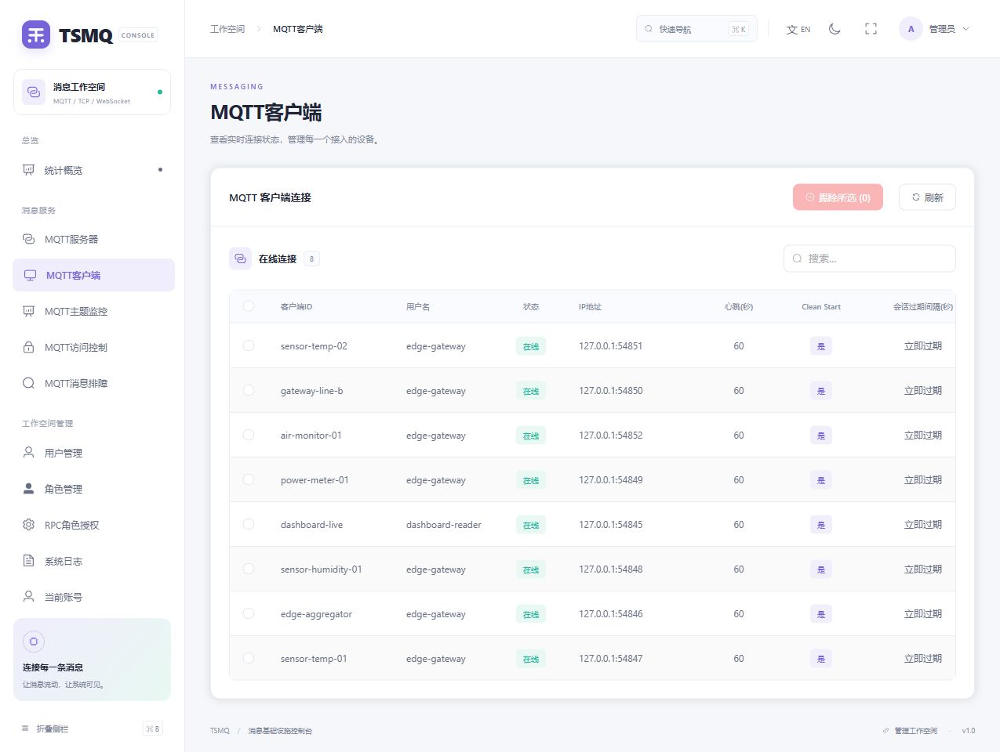
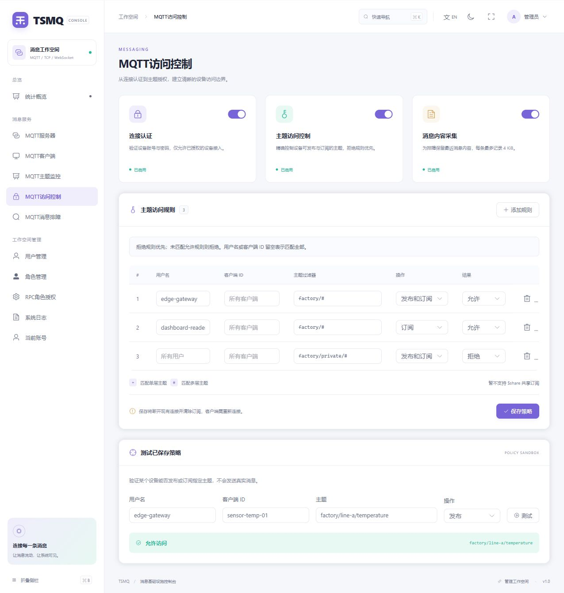
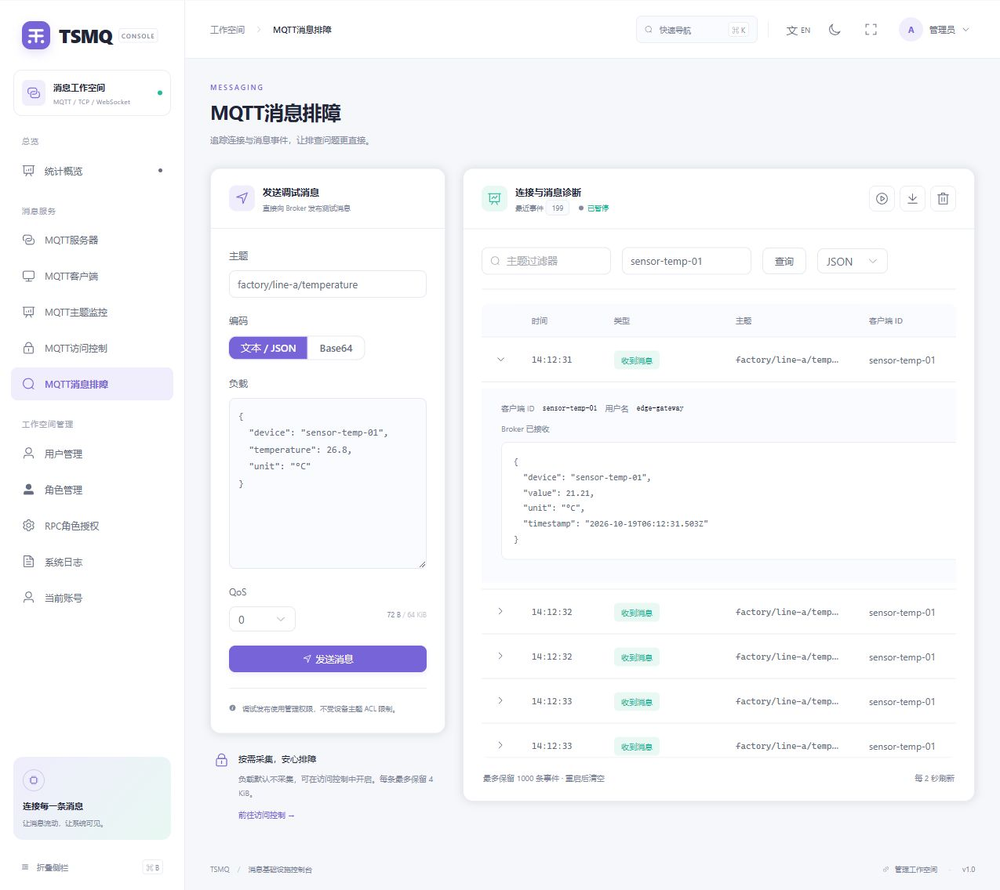
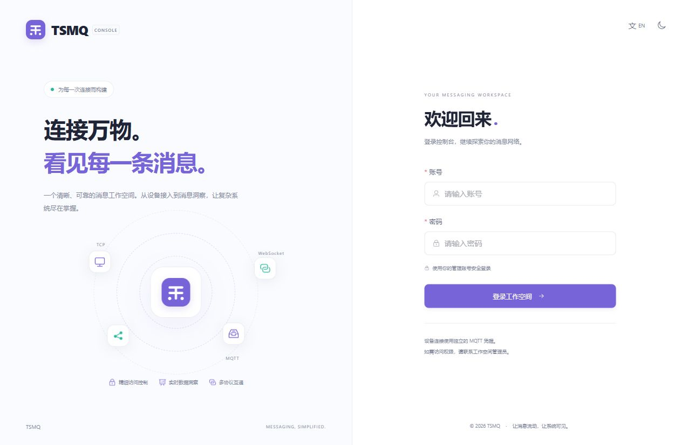

# TSMQ

**自带 Web 管理控制台的轻量级 MQTT 消息服务。**

连接设备、查看消息流量、配置访问权限、定位通信问题，都可以在浏览器中完成。适用于物联网接入、边缘网关、设备联调和小型消息服务部署，基于 [TouchSocket](https://touchsocket.net/) 构建。

[下载最新版本](https://github.com/RRQM/TSMQ/releases) · [下载并运行](#下载并运行) · [看看能做什么](#web-管理一览) · [开源协议](LICENSE)



> 截图来自独立演示环境，使用实际 MQTT 客户端连接和消息流量。界面对应当前仓库版本，发布包功能以相应版本说明为准。

## 下载并运行

### 1. 下载发布包

打开 [Releases](https://github.com/RRQM/TSMQ/releases)，展开所选版本的 **Assets**，下载对应平台的完整发布包。

| 平台 | 选择的附件 |
| --- | --- |
| Windows x64 | `tsmq-server-win-x64-*.zip` |
| macOS Apple Silicon | `tsmq-server-osx-arm64-*.zip` |
| Linux x64 / ARM64 | 对应 `amd64` / `arm64` 的 Docker 镜像 `.tar` 文件，或使用下方容器镜像 |

请下载发布附件，而不是页面底部的 `Source code`。Windows、macOS 发布包为 AOT 程序，无需另外安装 .NET 或 Node.js。

### 2. 解压并启动

**Windows：** 将压缩包完整解压到可写目录，双击 `TSMQServer.App.exe`，保持运行窗口打开。

**macOS：** 解压后，在程序目录打开终端运行：

```sh
chmod +x TSMQServer.App
./TSMQServer.App
```

启动成功后，窗口会显示实际监听地址、本机及网卡对应的 Web 地址、MQTT 监听器状态，以及数据库与日志目录。

<details>
<summary>Linux / Docker 运行方式</summary>

使用发布的容器镜像启动，数据和日志分别保存在持久卷中：

```sh
docker run -d \
  --name tsmq \
  --restart unless-stopped \
  --entrypoint /app/TSMQServer.App \
  --workdir /data \
  -p 7789:7789 \
  -p 1883:1883 \
  -p 8083:8083 \
  -v tsmq-data:/data \
  -v tsmq-logs:/app/logs \
  ghcr.io/rrqm/tsmq-server:latest
```

也可以下载 Release 中对应架构的 Docker `.tar` 文件，通过 `docker load -i 文件名.tar` 导入，并将上述命令最后的镜像名替换为导入后的镜像名与标签。

`1883`、`8083` 是预留的 MQTT 映射端口，仍需登录 Web 控制台创建相应的 TCP、WebSocket 监听器。使用其他端口时，需要同步调整容器端口映射。

</details>

### 3. 打开 Web 控制台

浏览器访问 **[http://127.0.0.1:7789/](http://127.0.0.1:7789/)**。如果调整过管理端口，以启动窗口显示的地址为准；从其他电脑访问时，将 `127.0.0.1` 换成服务器 IP。

首次启动会初始化管理账号：

| 账号 | 密码 |
| --- | --- |
| `admin` | `admin123` |

登录后请在“用户管理”中修改当前账号的默认密码。Web 管理账号和 MQTT 设备账号分别管理。

### 4. 接入第一个 MQTT 客户端

1. 在 **MQTT服务器 → 连接授权** 中添加设备使用的 MQTT 用户名和密码。
2. 在 **MQTT服务器 → 服务器列表** 中新增并启动 TCP 或 WebSocket 监听器。
3. 在 **MQTT访问控制** 中检查连接认证；需要限制主题时，开启主题访问控制并配置允许规则。
4. 使用 MQTTX、MQTT Explorer 或设备 SDK，填写服务器 IP、所建监听器的端口及 MQTT 凭据，连接后发布、订阅消息。

**默认的 `7789` 是 Web 与管理接口端口。MQTT 接入端口由你在控制台创建，不会默认自动开放 `1883`。**

## Web 管理一览

### 统计大屏：一眼看清消息服务的运行状态

在线客户端、活跃主题、累计收发消息、数据吞吐与丢弃原因集中呈现。支持实时刷新、暂停观察和历史趋势切换。



### 监听器管理：在浏览器里接入设备

动态添加、启动、停止 TCP 与 WebSocket 监听器，管理 MQTT 设备凭据、TLS 证书及 Broker 参数。同一实例内的各监听器共享 Broker，TCP 和 WebSocket 客户端之间可以交换消息。



### 客户端管理：找到每一个在线设备

查看客户端 ID、用户名、连接地址、连接时间等信息，支持搜索和断开连接；配合主题监控，查看订阅者及主题消息统计。



### 访问控制：决定谁能连接、能操作哪些主题

分别控制连接认证、主题 ACL 和诊断负载采集。规则可按用户名、客户端 ID、主题过滤器及发布／订阅操作设置，并支持在页面上测试已保存策略。



启用主题 ACL 后，拒绝规则优先，未匹配允许规则的请求会被拒绝。主题过滤器支持 `+`、`#`；保存策略会撤销已有连接和订阅，客户端需要重新连接。

### 消息排障：从连接事件追到消息内容

在同一页面发送调试消息、筛选客户端和主题事件，查看连接拒绝、权限拒绝、订阅及消息记录。负载可按文本、JSON 或 Hex 查看，事件支持暂停、清空视图和导出。



负载默认不采集，开启后每条最多保留 4 KiB；诊断事件为内存中的近期记录，重启后清空。管理端调试发布使用管理权限，不受设备主题 ACL 限制。

### 团队管理与界面偏好

通过用户、角色和 RPC 权限管理，为不同成员配置可访问的页面与操作。系统日志支持按日期、级别、分类和关键词检索。

控制台支持 **浅色 / 深色主题、中英文切换、紧凑侧栏、快捷页面搜索及手机访问**，外观与语言偏好自动保存在当前浏览器。



## 日常使用

| 想做什么 | 去哪里 |
| --- | --- |
| 看运行状态和消息趋势 | 统计概览 |
| 创建 MQTT 端口、配置设备账号和证书 | MQTT服务器 |
| 查设备是否在线、断开指定连接 | MQTT客户端 |
| 查主题及订阅者、观察主题流量 | MQTT主题监控 |
| 配置连接认证和主题权限 | MQTT访问控制 |
| 发送测试消息、追踪收发事件 | MQTT消息排障 |
| 管理团队账号和操作权限 | 用户管理 / 角色管理 / RPC角色授权 |
| 查服务端异常和运行记录 | 系统日志 |

## 运行与维护

- **更换管理端口：** 修改发布目录中 `appsettings.json` 的 `Server.Port`，重启生效。MQTT 监听器端口在 Web 中管理。
- **查看日志：** 默认写入程序目录下的 `logs` 文件夹。控制台显示 Info 及以上日志，文件保留 Debug 详情。
- **备份与升级：** 先停止服务，再备份运行目录中的 `TSMQ.db` 和自定义配置；升级时保留数据库及原有配置，从原运行目录启动。
- **远程访问：** 使用启动窗口显示的网卡地址，并按需放行管理端口和已配置的 MQTT 端口。`0.0.0.0` 表示监听所有网卡，访问时应使用实际 IP 或域名。
- **Windows 后台运行：** 发布包内提供 `create.bat`、`start.bat`、`stop.bat`、`delete.bat`，可使用管理员权限管理 Windows 服务。

当前提供单实例 Broker 管理，同一实例内支持多监听器互通；暂不支持集群和 `$share` 共享订阅。

## 相关链接

[发布下载](https://github.com/RRQM/TSMQ/releases) · [问题反馈](https://github.com/RRQM/TSMQ/issues) · [TouchSocket 官网](https://touchsocket.net/) · [TouchSocket 仓库](https://github.com/RRQM/TouchSocket)

本项目采用 [Apache License 2.0](LICENSE) 开源协议。
